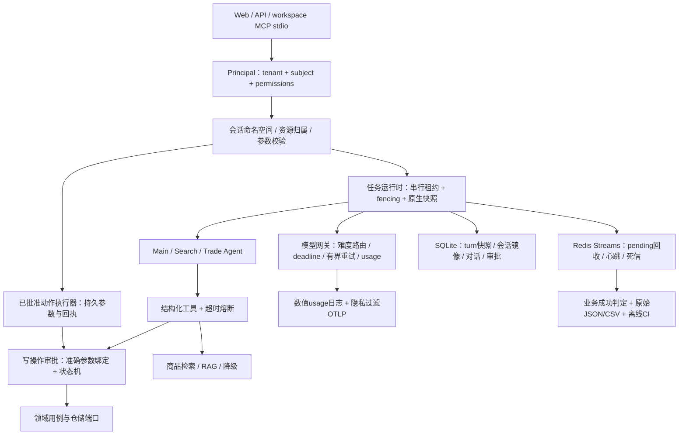
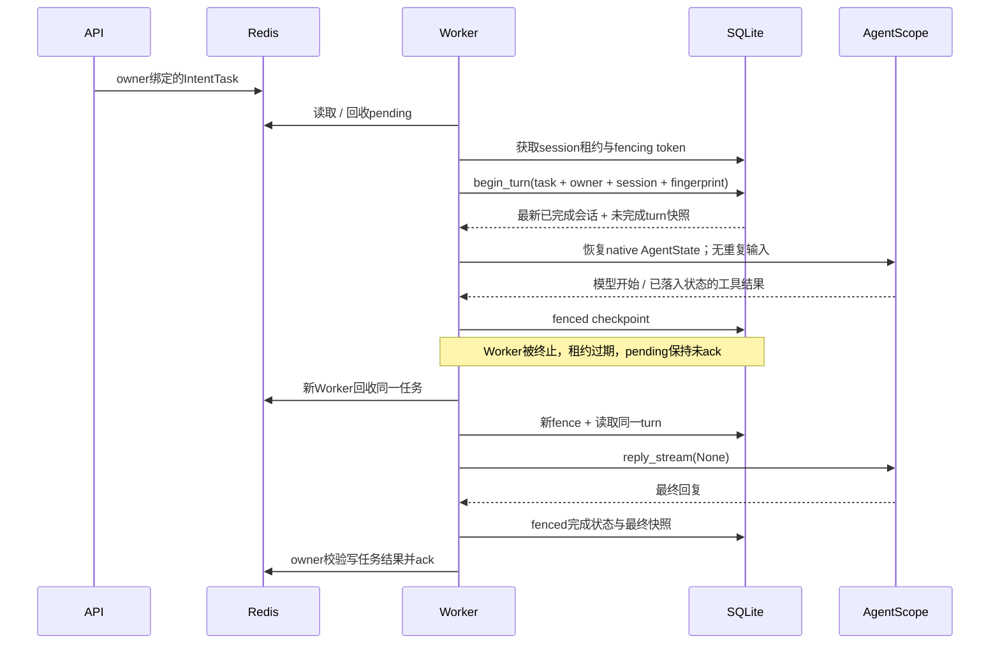
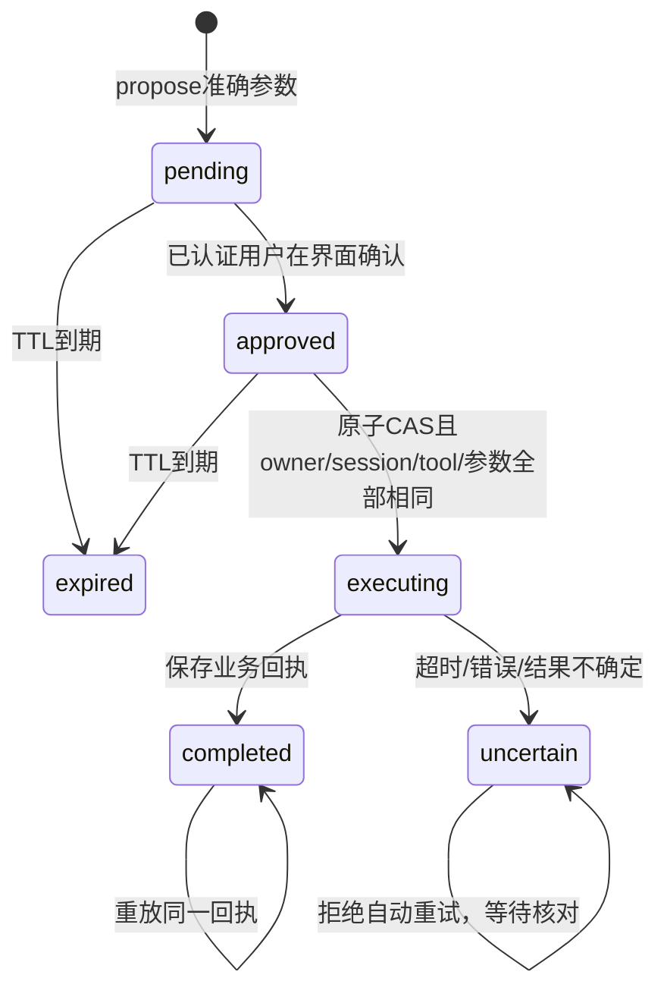

# Globex 运行时补强：设计、实现与边界

本次基于 main `baa675bd418f3ea751aaa2f6997d72005ef434a2` 的实际代码和 291 项测试推进。保留 Python / AgentScope 2.0.6、DDD 用例与商品规则；新增工程控制面。商品和库存仍为种子目录，不是接入商家系统的生产交易平台。验收结果见 [验收记录](runtime-acceptance.md)。

## 分层与责任

MCP 是协议适配层，不能替代业务用例、任务运行时、模型网关或权限模型。所有 MCP 调用经同一个受保护 API，不能通过工具参数指定身份、URL、文件路径或任意命令。当前 stdio 进程与一个 workspace 身份绑定；服务型多租户 MCP 的 OAuth、逐请求身份和租户路由仍需另行实现。

## 身份、workspace 与记忆

`AuthDirectory` 将不透明 Bearer token 映射到不可变 `Principal`，目录内部保存 token 哈希。没有配置身份目录就拒绝所有 commerce 请求；不创建默认管理员。`buyer_id` 不再构成授权依据。兼容字段必须等于已认证 subject。

`buyer_key = SHA256(tenant_id + NUL + subject)` 的摘要隔离订单和偏好；会话 ID 加相同 owner 摘要命名空间，因此相同用户输入 session ID 在不同租户仍指向不同状态。已带其他 owner 前缀的会话直接拒绝。HTTP、任务查询、订单查询/取消和 WS 都执行归属检查。WS 凭证位于首帧，不放 URL。浏览器 token 仅放 sessionStorage，切换身份清空视图。

这是静态身份适配器，尚未实现 OIDC/JWKS、短期凭证、实时吊销、服务间身份或细粒度组织 RBAC。接 IdP 时应替换 AuthDirectory 的认证入口，保留 Principal 和 resource owner 检查；不能重新相信客户端 buyer_id。workspace 扩展成显式 ID 后，所有业务表、缓存、租约和审批绑定应包含 tenant/workspace，而不只换前端字段。

原生上下文和长期偏好分开：前者是可恢复执行状态，后者是有用户归属的长期事实；本轮执行用 ContextVar 传递可信快照，模型不能修改权限或审批 ID。存储读取失败或快照损坏在生产装配中明确失败，不能静默开始一个空会话。数据库仍保存原始对话，生产需要访问控制、保留期限、删除和静态加密。

## 中断恢复与并发

同进程用 session asyncio 锁，跨 API/Worker 用 SQLite session 租约。租约有递增 fencing token、心跳、过期接管与有界等待；旧持有者不能再更新 turn。`task_id` 精确绑定 owner、session 和输入指纹；已完成任务返回原结果，参数变更构成冲突。

恢复使用 SDK 的 AgentState JSON，不自己拼 transcript。仅在模型开始以及原生 state 已包含匹配 ToolResultBlock 的工具完成边界保存。SDK 有某些“先发 End 事件，再存工具结果”的路径，所以只收到事件并不足以认定可安全保存。恢复未完成 turn 用 `reply_stream(None)`，避免再次追加输入、重复已完成检索。最终回复生成、输出审核和最终快照完成后才写 done。

Redis Streams 为 at-least-once。正常和大请求流共享总并发上限；周期回收 stale pending，活动任务续租；超出交付次数进入死信并落 failed。旧 consumer 对 status、ack、heartbeat 的操作要原子检查 pending owner，不能先查后改。Redis 最终状态与 SQLite 快照依然不是跨系统原子事务；完成快照使重投可以重放结果。

SQL session_store 是兼容镜像，不能宣称其与 turn 表原子提交。权威恢复记录是 fenced turn checkpoint；会话镜像仍需排障。方案要求 API 与 Worker 共享同一持久目录；跨机器应把租约、快照和审批迁移到 PostgreSQL 等服务存储，并用数据库时钟与迁移管理，不能把本地 SQLite 当成分布式控制面。

## 写操作审批与幂等边界

自然语言“确认”不是授权凭证。模型生成的写工具只提出准确商品、数量、地址或取消原因；界面显示全部参数，人工通过独立 API 批准。审批 ID 只从可信请求上下文进入 middleware，模型工具参数不能自授权限。缺少 commerce:write、缺少审批服务、替换参数、跨 owner/session、过期或未知状态均拒绝。

`WriteApprovalMiddleware` 位于订单写工具韧性层外。获批前没有业务副作用；成功回执持久化后重复调用重放。即使 WS 丢失，前端也可按会话读取持久审批并恢复卡片。正在 executing 或 uncertain 的动作不能自动重新下单。

不宣称外部副作用 Exactly Once：审批、订单、库存或外部支付之间尚无同一事务。进程可能在副作用后、回执前被杀，必须依赖商家幂等键和核对接口确认结果；当前拒绝自动重放该危险区间。库存为各进程内存副本，不能生产扣减；下一步应将库存和订单置于同一数据库事务，外部执行用 outbox/inbox、唯一业务键、补偿与核对，不能靠增加重试解决。

获批后前端调用专用 execute 端点，服务端从审批记录载入准确工具与参数，通过同一 WriteApprovalMiddleware 执行。客户端不能传新参数，不再让 LLM 重新规划写动作。界面只在持久记录为 completed 且有回执时显示完成；刷新后读取 pending、approved、executing、uncertain 记录，批准但未执行的动作可人工继续，不确定动作只允许核对。

幂等输入绑定在入队前查询持久 turn 记录，并使用与 Worker 相同的 canonical fingerprint。即使 Redis 的10分钟标记已到期，相同 task_id 更换参数也会在 API 返回409，而不是入队后变成后台失败。

MCP research 使用异步入队，立即返回 task_id，再通过 task_status 查询，避免长任务在同步客户端超时后丢失句柄。研究能力要求启用 Redis 队列；未启用时明确返回503，不静默切换同步端点。

## 模型网关与意图分流

配置主模型、可选小模型与故障 fallback。任务分类返回带 policy_version、reason、confidence 的结构化决策。V1 是保守的确定性政策：明确短单品检索可以用 small；交易、比较、多条件、长输入和未知用 main。没有小模型配置则保持主模型。分类不授予任何工具权限。

预算降级与任务难度是两条轴：预算 tier 非 main 维持原有降级策略；有预算时再按任务政策选 small/main。小模型瞬时故障可在剩余总 deadline 内升级主模型；非重试 HTTP 4xx 直接失败；流已经输出后不再拼接另一个模型的答案。SDK 自带重试关闭，由网关统一控制有界重试、退避、请求超时和整体调用期限；slot 覆盖完整流生命周期，取消也要释放。

`LLM_SMALL_MODEL` 空时新路由不影响上游选择。V1 的 confidence 是规则决策值，不是测出来的概率；是否提高真实质量、节约多少钱需要标注集和在线 provider 用量验证。将来接 TypeSafe/JEV 应通过 classifier 适配端口输出相同 schema，低置信度/未知/漂移进入主模型，shadow 比较误分率；不能把意图分类器当权限系统。

usage 来自 provider 返回字段；缺失标 UNKNOWN，不能用估算 Token 冒充实际消费。配置 `LLM_PRICING_VERSION` 与模型单价后计算明确标注的 estimated_cost，账单金额仍为空。当前用量日志与有界请求治理不等于财务级租户账本或集群统一限流；后者要单独持久化 attempt/id、预留额度、释放与结算，并与 provider 账单对账。

单次处理期限 TASK_TIMEOUT_SECONDS 默认300秒，覆盖会话等待与一轮编排；生产快照路径不增加另一层整轮模型重试。Worker重投由交付次数上限控制。跨重启的绝对任务截止时间与持久预算结算仍需后续控制面实现，不能把本地计时器称作全生命周期预算。

## 可观测、评测与飞轮

OTLP 导出器在出口只保留 span 时间、父子关系、状态码和数值 usage；过滤提示词、工具参数、结果、异常正文、事件、原始名称和其他属性。隐私优先的默认配置会损失细粒度工具名，后续可增加受控枚举、脱敏摘要与经审计的采样。当前已验证过滤逻辑；实际 Langfuse/collector 接收与线上 Token 是 UNVERIFIED。

loadtest 的成功必须同时满足 HTTP 2xx、非空 final_text 且无错误标记。保存逐请求 JSON/CSV、请求/响应、耗时、失败类型、重复编号、并发度、脚本 hash、Git 基线、平台与 SYNTHETIC/live 标签。三次 1/2 并发离线运行验证记录和流程，不证明生产 p95、模型质量或财务收益。

完整自动改进闭环的后续设计：

1. 收集带 consent/保留期限的任务事实：版本、路由、工具证据、provider usage、人工反馈、可验证结果；脱敏后进入 append-only 事件与版本化数据集。
2. 数据切分以用户/任务实体隔离，固定 held-out、安全集和挑战集；同一真实任务不能同时出现在训练与验收里。失败先分类为数据缺失、检索、路由、规划、工具、基础设施，避免靠调 prompt 掩盖存储错误。
3. 提交候选版本：prompt、路由、检索权重或模型配置作为不可变 bundle；记录 parent、训练窗口、评测集 hash 和配置。候选不能修改生产执行中的版本。
4. 消融与成对对照使用相同任务集、数据快照和预算，至少三次重复；比较事实正确率、安全写违规、工具成功率、实际成本、尾延迟。没有显著样本证据就保持 incumbent，不以单次 LLM judge 判定升级。
5. 达到预先定义门槛后 shadow→有界 canary→原子指针晋级；出现安全回归、失败率/成本超限即回滚。用户已同意自动更新时仍需这些可复现门槛，不能无限试验直到“跑赢”。

**上述完整自动晋级飞轮尚未实现。**本轮交付了正确结果判定、原始记录、版本指纹、固定测试与故障验收这些基础；不把日志积累称作自进化。金融选股、点时数据与十年回测属于 FinAgent 的业务域，不是把电商种子目录改名就得到的能力。

## 已知后续中间件与落地难点

| 能力 | 本轮已有 | 后续实现及难点 |
|---|---|---|
| 身份平台 | Principal、资源归属、静态目录 | OIDC、服务身份、workspace模型、吊销与细粒度RBAC |
| 任务控制面 | 原生快照、session租约、turn重放 | PostgreSQL迁移、持久子任务DAG、暂停/取消/任务版本、状态保留与清理 |
| 消息可靠性 | Redis pending、续租、死信 | transactional outbox、背板重连/可重放事件、多租户公平调度 |
| 交易存储 | 审批账本、owner校验、回执 | 持久库存与事务、外部商家幂等和结果核对 |
| 模型治理 | 请求期限、路由、降级、真实/未知usage | 集群配额、租户成本账本、灰度、供应商账单核对 |
| MCP | 受认证API约束的workspace stdio | OAuth Streamable HTTP、工具版本注册、Schema兼容与凭证委派 |
| Trace | 默认出口内容过滤 | Collector/Langfuse线上核验、受控枚举与采样、指标及告警 |
| 自动改进 | 测试/原始记录/故障验收 | 数据集版本、shadow/canary、统计门槛、候选版本自动晋级与回滚 |

这些项目有明确实现方案，但不能将它们写进“已完成”的面试经历。可讲清本轮真实修复、负测、Worker恢复证据和工程边界，随后讨论扩大部署所需的迁移。
